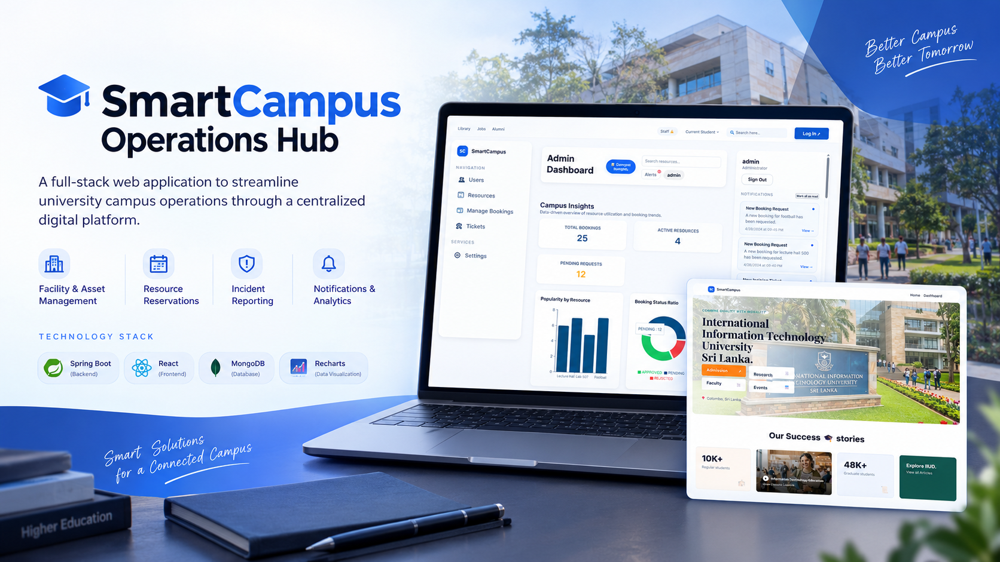

# SmartCampus Operations Hub

<p align="center">
  
</p>

**A Full-Stack Campus Management Platform**

SmartCampus Operations Hub is a full-stack web application developed as an academic team project to streamline university campus operations through a centralized digital platform. It brings together facility and asset management, resource reservations, incident reporting, notifications, and administrative analytics.

The platform is designed to improve operational efficiency, simplify campus service management, and support data-informed decision-making.

## Key Features

### 🏢 Facilities and Asset Management
- Browse and manage campus facilities such as lecture halls, laboratories, meeting rooms, and equipment.
- Search and filter resources by relevant attributes, including type, location, capacity, and availability.
- Support administrative management of campus resources.
- Provide insights into resource utilization and usage patterns.

### 📅 Booking Management
- Support online reservations for campus facilities and resources.
- Manage booking requests through approval and rejection workflows.
- Track booking statuses and reservation activity.
- Provide booking-related analytics, including resource popularity and usage trends.

### 🎫 Incident Ticket Management
- Report campus incidents and maintenance requests.
- Track tickets throughout their resolution lifecycle.
- Support ticket assignment and management based on user roles.
- Facilitate communication through ticket comments and updates.
- Provide visibility into ticket statuses and operational trends.

### 🔔 Notifications
- Notify users about relevant booking updates and ticket status changes.
- Support alerts related to technician assignments and operational activities.
- Provide a centralized notification experience.

### 🔐 Authentication and Access Control
- Integrate Google OAuth 2.0 sign-in, subject to provider configuration.
- Apply role-based access control for user, technician, and administrator workflows.
- Support secure access to protected application endpoints.
- Include authentication-related capabilities such as JWT authorization and multi-factor authentication where configured.

### 📊 Analytics and Insights
- Resource utilization and popularity analysis.
- Booking trends and approval statistics.
- Incident ticket status monitoring.
- Operational dashboards to help administrators understand campus activity.

## Technology Stack

| Layer | Technologies |
|---|---|
| Frontend | React, JavaScript, React Router |
| UI and Data Visualization | CSS, Recharts |
| Frontend State Management | React Context API |
| API Communication | Axios, REST APIs |
| Backend | Java 17, Spring Boot |
| Security | Spring Security, OAuth 2.0 integration |
| Databases | MongoDB, H2 for local development/testing where configured |
| Build Tools | Maven, npm |
| Development Tools | Git, GitHub, VS Code |

## System Architecture

The application uses a frontend–backend architecture.

```text
┌──────────────────────────────┐
│       React Frontend         │
│   Pages, Forms, Dashboards   │
└──────────────┬───────────────┘
               │
               │ HTTP / REST API
               ▼
┌──────────────────────────────┐
│     Spring Boot Backend      │
│ Controllers, Services,       │
│ Security and Business Logic  │
└──────────────┬───────────────┘
               │
               ▼
┌──────────────────────────────┐
│       Data Persistence       │
│ MongoDB / H2 as configured   │
└──────────────────────────────┘

 External authentication:
 Google OAuth 2.0 (when configured)
```

## Project Structure

```text
smart-campus-hub/
├── backend/       # Spring Boot backend and REST APIs
├── frontend/      # React and Vite frontend
├── .mvn/          # Maven wrapper configuration
├── .gitignore
├── mvnw
├── mvnw.cmd
└── README.md
```

## Getting Started

### Prerequisites

Install the following tools before running the application:

- Java 17 or a compatible JDK
- Apache Maven
- Node.js and npm
- MongoDB, if required by the selected application configuration

### 1. Clone the Repository

```bash
git clone <YOUR_GITHUB_REPOSITORY_URL>
cd smart-campus-hub
```

Replace the repository URL with your GitHub repository URL.

### 2. Start the Backend

From the project root, run:

```bash
mvn -f backend/pom.xml spring-boot:run
```

The backend is configured to run on port `8081`.

### 3. Start the Frontend

Open a second terminal:

```bash
cd frontend
npm install
npm run dev
```

Open the local development URL displayed in the terminal.

### 4. Configure Local Services

Before using features that depend on external services:

- Configure database connection settings for your environment.
- Provide valid Google OAuth credentials if Google sign-in is required.
- Configure any additional authentication or notification services required by the application.

**Security note:** Keep passwords, API keys, OAuth secrets, database credentials, and local environment files out of version control.

## Project Objectives

- Centralize common campus operational workflows.
- Improve visibility into facility bookings and maintenance requests.
- Support communication between users and campus administrators.
- Provide analytics to assist operational planning.
- Apply structured backend development, frontend integration, and access-control concepts.

## Future Improvements

Potential areas for further development include:

- Expanded reporting and interactive analytics.
- Improved automated testing and continuous integration.
- Enhanced monitoring and deployment workflows.
- Further improvements to accessibility, performance, and usability.

## Project Context

**Type:** Academic team project  
**Application:** Web-based campus operations platform  
**Primary contribution:** Incident Ticket Management  
**Purpose:** Educational and portfolio demonstration
